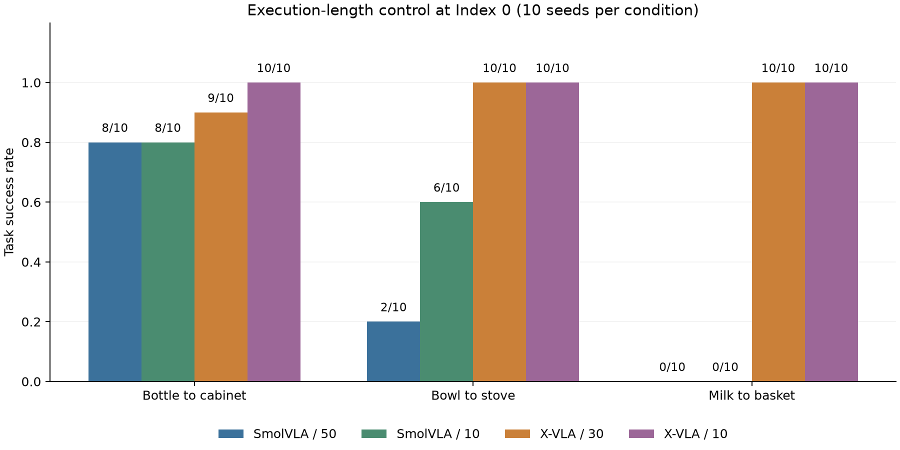

# SmolVLA 与 X-VLA 的 LIBERO 仿真对照

具身智能课程项目。在 Apple M5 上对两个视觉–语言–动作（VLA）检查点进行 **236 轮仿真**，比较三项桌面操作任务。实验覆盖四个初始状态，并通过统一动作重预测频率、相机置黑和抬升干预，检查模型差距体现在哪些行为阶段。

[完整实验报告](docs/report.md) · [12 页汇报 PPT](docs/presentation.pptx) · [236 轮结果表](experiments/phase2/all_mac_episodes.csv) · [仿真视频](demos/README.md) · [复现说明](docs/reproduction.md)

## 主要结果

以下均为初始状态 Index 0，每项任务每个条件运行 10 次。步数表示每次预测后连续执行多少步，再采集新观测进行预测。

| 模型与执行设置 | 酒瓶放柜顶 | 黑碗放炉子 | 牛奶入篮 |
| --- | ---: | ---: | ---: |
| SmolVLA · 50 步 | 8/10 | 2/10 | 0/10 |
| SmolVLA · 10 步 | 8/10 | 6/10 | 0/10 |
| X-VLA · 30 步 | 9/10 | 10/10 | 10/10 |
| X-VLA · 10 步 | 10/10 | 10/10 | 10/10 |

- **重预测频率。** 缩短 SmolVLA 的执行长度后，黑碗成功从 2/10 增至 6/10，牛奶仍为 0/10。统一为 10 步后，X-VLA 在三个任务上的成功次数均更高。
- **额外初始状态。** Index 1、2、3 各运行 3 次。默认执行设置下，SmolVLA 三项任务依次为 7/9、0/9、0/9，X-VLA 三项均为 9/9。
- **抬升干预。** 80 步几何抬升在全部 6 次触发中使牛奶盒底越过篮沿，完整任务仍为 0/10。
- **相机置黑。** 牛奶任务中，X-VLA 正常双视角为 3/3，外部或腕部任一视角置黑后均为 0/3。每个条件只覆盖三个种子。

成功按 LIBERO 环境 Goal 判定。本次评估使用已有检查点，结论限于所测任务和初始状态。两套检查点在训练覆盖、参数量、精度和动作表示上同时存在差异，单个内部模块的贡献仍待独立检验。

## 实验数据与代码

| 内容 | 入口 |
| --- | --- |
| 90 轮基线 | [配置](experiments/experiment_config.json) · [汇总](experiments/summary.csv) |
| 116 轮主方案 | [协议](experiments/phase2/protocol.json) · [汇总](experiments/phase2/summary.csv) |
| 10 轮 40 步几何抬升和 20 轮 80 步配对校准 | [40 步协议](experiments/phase2/followup/protocol.json) · [80 步协议](experiments/phase2/clearance_calibration/protocol.json) |
| 逐轮 Goal、动作阶段指标和遮挡组输入帧 | [结果索引](experiments/phase2/all_mac_episodes.csv) · [指标与审计说明](docs/reproduction.md) |
| 仿真与绘图 | [第一阶段脚本](experiments/scripts) · [第二阶段脚本](experiments/phase2/scripts) |

## 来源

模型和基准见 [SmolVLA 论文](https://arxiv.org/abs/2506.01844)、[X-VLA 论文](https://arxiv.org/abs/2510.10274)和 [LIBERO 论文](https://arxiv.org/abs/2306.03310)。任务定义基于 LIBERO 场景，附有 [LIBERO 许可声明](experiments/tasks/LIBERO-LICENSE.txt)。[论文与模型说明](docs/models-and-references.md)
