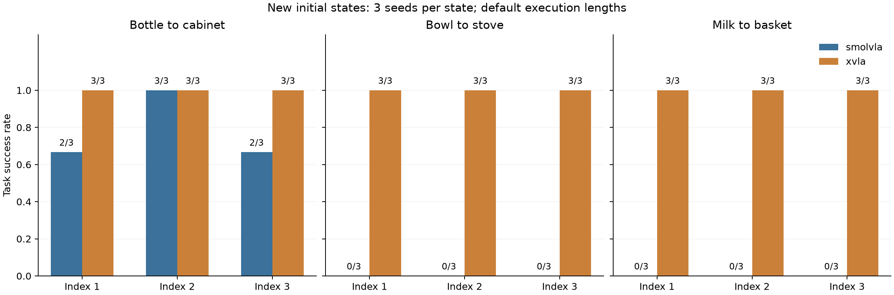
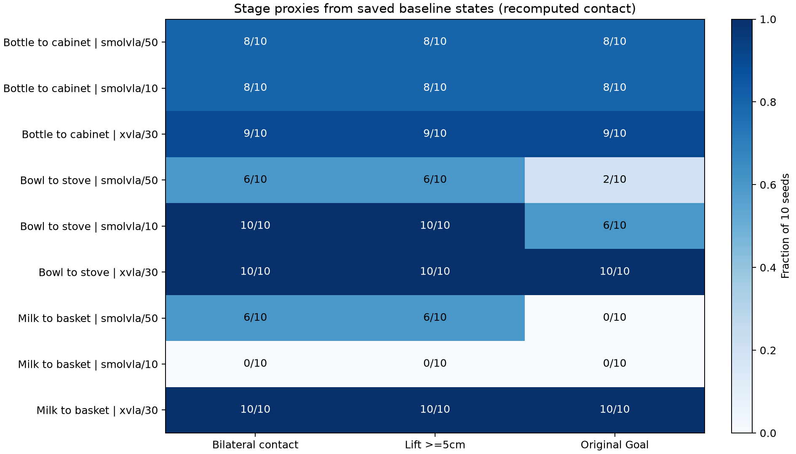
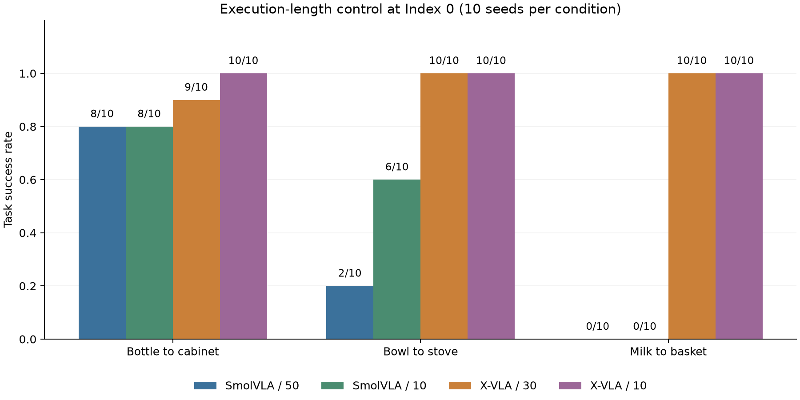
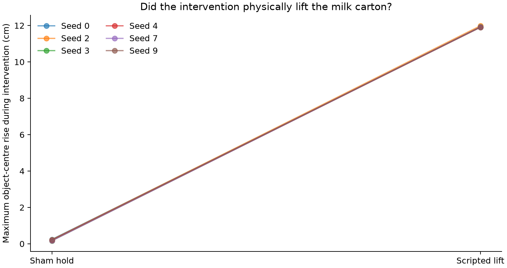
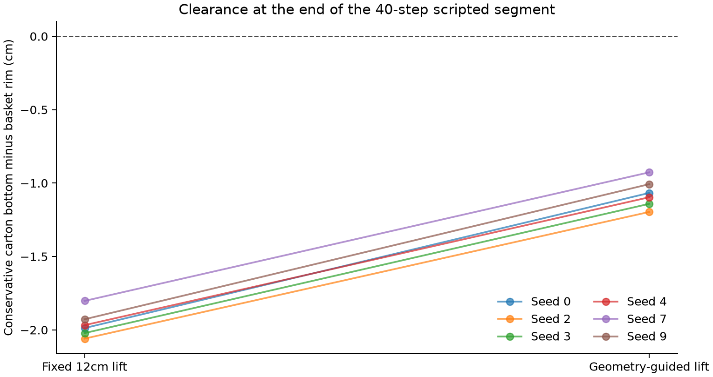
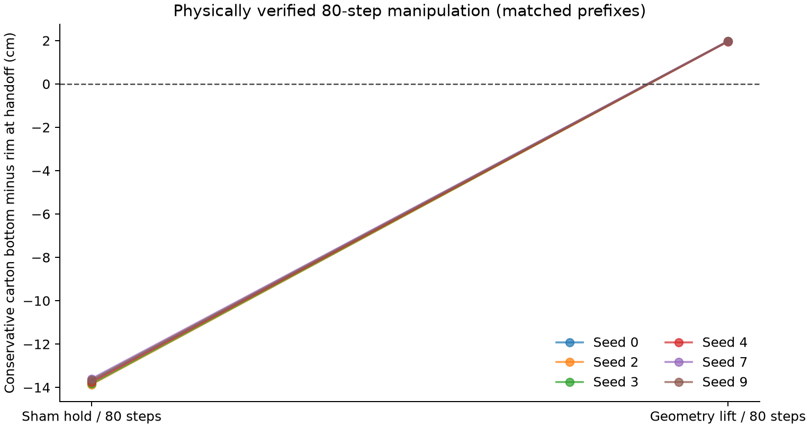

# 从性能差异到失败环节：Mac归因实验

状态：完成；主方案新增 116/116，40步几何后续 10/10，80步校准对照 20/20，复用基线90回合。生成于2026-11-04T16:35:48+08:00。

[完整实验报告](../../docs/report.md)

[最终汇报 PPT](../../docs/presentation.pptx)

[论文与模型说明](../../docs/models-and-references.md) · [代表视频](../../demos/README.md)

## 研究问题与证据层级

先确认模型差异在其他初始状态是否保留，再分解接近、接触、抬升、放置，控制动作执行频率，并用抬升/等时停留与相机遮挡测试局部假设。
此实验定位行为瓶颈与输入敏感性；没有用相同数据重新训练模型，因此不能独立归因于视觉骨干、soft prompt、训练数据、参数规模、精度或动作表示。

## 固定方案

- 新状态：Index1/2/3，每状态种子0/1/2，三个任务、两模型默认执行长度，共54轮。
- 匹配执行频率：补X-VLA执行10步，三个任务各10种子，共30轮；对应SmolVLA10步数据复用基线。
- 牛奶干预：SmolVLA默认50步，连续3步双指接触后触发，抬升组与等时停留组各10种子，共20轮。
- 牛奶相机遮挡：两模型分别将外部/腕部相机输入置黑，每设置3种子，共12轮。
- 每轮最多800步，沿用原Goal，串行MPS运行，每轮前30秒连续正常热状态，非正常状态/低内存停止。
- 主方案116轮的条件与阈值在主方案结果前固定；40步几何补充、80步工程校准和额外几何诊断是在对应操控检查后另行固定的探索性补充，分别说明。

## 1. 优势是否依赖初始布局

|任务|Index|SmolVLA默认|X-VLA默认|
|---|---:|---:|---:|
|酒瓶|0|3/3|2/3|
|酒瓶|1|2/3|3/3|
|酒瓶|2|3/3|3/3|
|酒瓶|3|2/3|3/3|
|黑碗|0|0/3|3/3|
|黑碗|1|0/3|3/3|
|黑碗|2|0/3|3/3|
|黑碗|3|0/3|3/3|
|牛奶|0|0/3|3/3|
|牛奶|1|0/3|3/3|
|牛奶|2|0/3|3/3|
|牛奶|3|0/3|3/3|

本表Index0也只取相同种子0/1/2，四个状态每设置均3次；Index0完整10次见第一阶段。种子嵌套在初始状态内。不要将同状态重复当作不同布局，也不要将Index变化称作相机机位变化。

## 2. 失败首先出现在哪个环节

|任务|模型/执行步数|连续双指接触|接触后抬升≥5cm|最终Goal|
|---|---|---:|---:|---:|
|酒瓶|smolvla/50|8/10|8/10|8/10|
|酒瓶|smolvla/10|8/10|8/10|8/10|
|酒瓶|xvla/30|9/10|9/10|9/10|
|黑碗|smolvla/50|6/10|6/10|2/10|
|黑碗|smolvla/10|10/10|10/10|6/10|
|黑碗|xvla/30|10/10|10/10|10/10|
|牛奶|smolvla/50|6/10|6/10|0/10|
|牛奶|smolvla/10|0/10|0/10|0/10|
|牛奶|xvla/30|10/10|10/10|10/10|

新状态在线指标（每任务每模型计划9轮，直接在原运行中记录接触，区别于上表的基线重放）：

|任务|模型|连续双指接触|接触后抬升≥5cm|最终Goal|
|---|---|---:|---:|---:|
|酒瓶|smolvla|7/9|7/9|7/9|
|酒瓶|xvla|9/9|9/9|9/9|
|黑碗|smolvla|4/9|4/9|0/9|
|黑碗|xvla|9/9|9/9|9/9|
|牛奶|smolvla|2/9|2/9|0/9|
|牛奶|xvla|9/9|9/9|9/9|

原协议还记录了末端site距物体原点<10cm的距离代理，但高酒瓶可在瓶颈处被抓住而中心距离仍大于10cm，故不将此指标作为抓取前置条件或转化漏斗。原始指标完整保留。本节以接触、抬升与Goal为主要过程证据。接触是双侧指垫与物体同时接触的代理，要求连续3步；抬升要求物体中心比初始参考升高5cm，且最近5步有双指接触。它们都不是稳定、安全抓取的充分条件。
基线只保存了动作后状态，位姿以首个已保存状态为参考；新增回合在线记录reset后的参考。基线接触由set_state+forward重算，90个末帧中85个重算Goal与原记录一致，5个SmolVLA黑碗成功末帧未重现接触Goal。状态快照没有保存完整接触/求解缓存，重放接触仅作阶段代理；所有最终Goal均沿用原始记录。
黑碗：50→10步后，连续接触与抬升由6/10升至10/10，但最终Goal仅6/10，表明接近抓取与后续放置都值得区分。牛奶：50步有6/10接触和抬升但无最终成功；10步组未检测到连续双指接触。图像上贴近或推动物体不应自动描述为稳定抓取。

### 牛奶的额外几何诊断（探索性）

从原90轮状态重放计算碰撞几何包围盒：SmolVLA50步已有6/10在近期双指接触下让盒底高于篮沿，X-VLA为10/10。但在同样有近期接触时，物体中心进入目标篮中心6cm水平半径的次数分别为0/10和10/10；SmolVLA10步两项均0/10。6cm仅为探索性近中心代理，不替代原Goal。
因此，牛奶差距不能只描述成是否抬得起来：已形成接触的SmolVLA默认回合也出现过正净空，却没有完成向目标篮中心附近的对齐与放置。这个行为差异仍不能独立区分视觉定位、语义目标选择和动作生成中的内部原因。原数据见analysis/baseline_clearance.json。

## 3. 匹配重新预测频率

|任务|SmolVLA50步|SmolVLA10步|X-VLA30步|X-VLA10步|
|---|---:|---:|---:|---:|
|酒瓶|8/10|8/10|9/10|10/10|
|黑碗|2/10|6/10|10/10|10/10|
|牛奶|0/10|0/10|10/10|10/10|

两模型执行10步意味着同样每10个仿真步重新预测，但相对/绝对动作、预测块总长度等仍不同。本对照只能检查默认执行频率是否足以解释差距，不能隔离动作表示的作用。

## 4. 牛奶抬升干预

|条件|Goal成功|触发次数|触发后成功|平均实际脚本步数|
|---|---:|---:|---:|---:|
|sham|0/10|6/10|0/6|24.0|
|lift|0/10|6/10|0/6|24.0|

触发后40个仿真步（2秒），两组均保持闭爪，随后清空动作队列重新预测。lift仅增加向上动作，末端高度目标为触发时+12cm；sham原位停留。脚本步数占用原800步预算。触发器读取仿真接触，几何后续组还读取碰撞包围盒，属于使用特权状态的手工控制干预；没有把这些真值作为新的VLA传感输入，也没有训练模型。未触发者仍纳入总成功率，不能挑出成功触发样本代替整体。
即使lift改善成功率，也只能支持这段控制干预有效，不能证明模型内部缺少物理知识。应同时检查实际物体抬升、是否掉落，以及sham是否也改善。

## 4b. 几何净空后续实验（探索性）

固定12cm干预的六个触发样本中，保守碰撞包围盒显示盒底仍低于篮沿约1.8–2.1cm。因此不能将其失败解释为已排除净空不足。随后另行固定10轮几何干预，目标是盒底高于篮沿2cm，仍为40个脚本步，与原sham复用相同种子并核对前缀。此设计是在看到原结果之后提出，属于单独的探索性后续实验。
几何净空组当前Goal：0/10。实际净空和前缀审计见followup/audit.json。

## 4c. 80步工程校准与配对停留（探索性）

40步几何控制首轮结束时盒底仍低于篮沿1.07cm，操控目标尚未实现；因此另行固定80步几何抬升及80步停留各10轮。参数选择基于物理目标实现检查，不按最终成功率搜索；原40步数据完整保留。所有脚本步均计入800步。
80步停留Goal：0/10；80步净空Goal：0/10。实际结束净空与前缀检查见clearance_calibration/audit.json。

## 5. 相机输入敏感性

|模型|原始双视角（相同3种子）|外部相机置黑|腕部相机置黑|
|---|---:|---:|---:|
|smolvla|0/3|0/3|0/3|
|xvla|3/3|0/3|0/3|

过程指标（正常输入取基线相同3种子，遮挡组在线记录）：

|模型|条件|连续双指接触|接触后抬升≥5cm|Goal|
|---|---|---:|---:|---:|
|smolvla|正常|2/3|2/3|0/3|
|smolvla|外部置黑|0/3|0/3|0/3|
|smolvla|腕部置黑|0/3|0/3|0/3|
|xvla|正常|3/3|3/3|3/3|
|xvla|外部置黑|0/3|0/3|0/3|
|xvla|腕部置黑|0/3|0/3|0/3|

SmolVLA的Goal虽存在地板效应，但过程指标仍可变化：正常输入的接触/抬升2/3在两种置黑条件均降至0/3，因此不能把相同的0/3最终成功率解释为不依赖视觉。基线接触来自重放，遮挡组为在线记录，仍保留测量来源差异。

置黑保留另一视角、机器人状态和指令，属于分布外输入干预。各遮挡回合保存input_*.png首帧；rollout.mp4仍为正常环境录像，不能将录像误当成策略实际看到的全部输入。它衡量对完整输入的敏感性，不能直接称为视觉编码器优劣。SmolVLA正常输入原本0/3，存在地板效应：置黑后仍0不能说明它不依赖该视角。每条件仅3次，主要用于探索。

## 温控与可复核性

- clearance_calibration/logs/audit_thermal.jsonl：热状态采样{'nominal': 2}；保护停止0；memory_pressure最低余量75%。
- clearance_calibration/logs/thermal.jsonl：热状态采样{'nominal': 292}；保护停止0；memory_pressure最低余量65%。
- followup/logs/audit_thermal.jsonl：热状态采样{'nominal': 1}；保护停止0；memory_pressure最低余量75%。
- followup/logs/thermal.jsonl：热状态采样{'nominal': 141}；保护停止0；memory_pressure最低余量66%。
- logs/audit_thermal.jsonl：热状态采样{'nominal': 5}；保护停止0；memory_pressure最低余量75%。
- logs/geometry_thermal.jsonl：热状态采样{'nominal': 4}；保护停止0；memory_pressure最低余量53%。
- logs/presentation_thermal.jsonl：热状态采样{'nominal': 8}；保护停止0；memory_pressure最低余量53%。
- logs/replay_thermal.jsonl：热状态采样{'nominal': 6}；保护停止0；memory_pressure最低余量75%。
- logs/thermal.jsonl：热状态采样{'nominal': 1546}；保护停止0；memory_pressure最低余量50%。

系统热状态不是摄氏温度。首次封装接口错误已修复并单独保留，不计任务失败。
[第一阶段汇总表](../summary.csv) · [冻结协议](protocol.json) · [基线阶段原始统计](analysis/baseline_metrics.json) · [主方案116轮](summary.csv) · [全部236轮索引](all_mac_episodes.csv)

## 解释边界

- 相同初始状态与种子编号不意味着两个模型使用相同随机噪声。
- 相机遮挡、脚本抬升均可能产生训练分布外状态；负结果不能证明相应信息或动作不重要。
- 只有三个任务、四个初始状态，不能声称所有机器人任务都由X-VLA解决。
- 牛奶场景含多个篮子，课程指令未显式加入左右消歧，本轮仍按BDDL指定basket_1计分；不能把目标篮偏离唯一解释为纯动作控制误差。
- 结构、预训练/适配数据、动作表示、模型规模与精度仍混合变化；要隔离这些因素，需匹配数据和训练预算的重新训练消融。
- Goal成立后立即结束，不额外验证松爪后长期稳定。

## 图表

